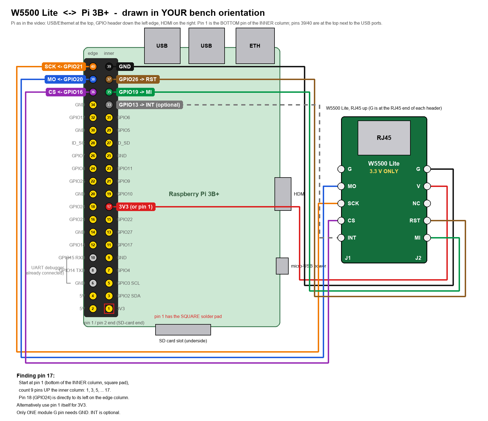

# w5500_test

Unity test app for the WIZnet W5500 Lite Ethernet module driver
(`drivers/w5500/`). Built from `test_apps/apps.json` for both platforms:

- `win-sim`: register layer, reset and init are exercised against
  `w5500_fake_bus.{c,h}`, a software model of the chip. Build and run with
  `python3 strat_build.py w5500_test --apps-config test_apps/apps.json --platform win-sim`
  then `timeout -s INT 10 stdbuf -o0 ./build/win-sim/w5500_test` (the sim never
  exits on its own). Hardware-only tests report `IGNORE`.
- `bcm2xxx` (Raspberry Pi 3B+): the same tests plus the hardware gates from
  `W5500_DRIVER_PLAN.md`; flash with `test.sh w5500_test`.

The first hardware test is a `VERSIONR` read (expect `0x04`), which proves
power, SPI wiring, and the bit-banged transaction before any MACRAW work.

## Wiring

Pin table: `platform/bcm2xxx/bcm_2xxx_spi.c`. Bring-up log: `../../W5500_BRINGUP_NOTES.md`.

| W5500 Lite | Pi header pin | GPIO | Config pin id |
|------------|---------------|------|---------------|
| V          | 17 (or 1)     | 3V3  | -             |
| G          | 39            | GND  | -             |
| SCK        | 40            | 21   | `SPI_MODULE_PIN_ID__SCLK` |
| MO         | 38            | 20   | `SPI_MODULE_PIN_ID__MOSI` |
| MI         | 35            | 19   | `SPI_MODULE_PIN_ID__MISO` |
| CS         | 36            | 16   | `SPI_MODULE_PIN_ID__CS_0` |
| RST        | 37            | 26   | `NET_HW_MODULE_PIN_ID__RST` |
| INT        | 33            | 13   | `NET_HW_MODULE_PIN_ID__INT` (optional) |

The W5500 Lite is 3.3 V only. `NC` and the second `G` stay unconnected.

- [docs/wiring_bench.png](./docs/wiring_bench.png): drawn in the bench
  orientation (USB ports up, header on the left, pin 1 at the bottom of the
  inner column).
- [docs/wiring_pinout.png](./docs/wiring_pinout.png): same wiring in the
  standard pinout.xyz orientation (pin 1 top-left).
- [docs/draw_wiring_bench.py](./docs/draw_wiring_bench.py): regenerates the
  bench diagram (`pip install pillow`, then run it).

